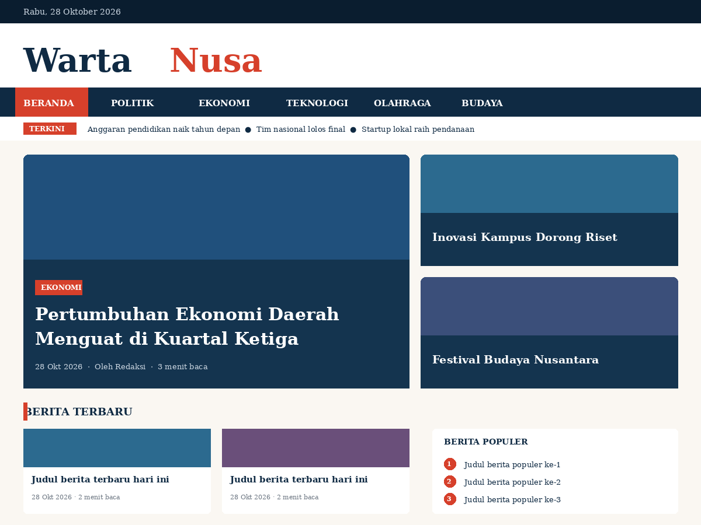

# Warta Nusa— WordPress Theme Portal Berita

**Warta Nusa** adalah tema WordPress bergaya editorial/majalah untuk portal berita. Tema dibuat dari nol (tanpa menyalin tema lain) sebagai tugas pengembangan tema pada matakuliah CMS. 



## Fitur

- Hero berita utama (1 besar + 2 pendukung) pada halaman depan
- Ticker "Terkini" berisi judul berita terbaru
- Blok berita per kategori (3 kategori dengan artikel terbanyak)
- Daftar artikel (blog/archive/search) dengan pagination bernomor
- Detail artikel: badge kategori, waktu baca, gambar unggulan, tag, tombol bagikan, kotak penulis, navigasi sebelumnya/berikutnya, berita terkait, komentar
- Sidebar widget (fallback otomatis: Berita Populer, Kategori, Tag) dan 3 kolom widget footer
- Menu navigasi: Menu Utama, Menu Atas, Menu Footer (dengan submenu dan menu seluler)
- Dukungan fitur WordPress: title-tag, featured image, custom logo, HTML5, responsive embeds, feed links
- Desain responsif (desktop, tablet, seluler) dan aksesibel (skip link, aria, `prefers-reduced-motion`)
- Identitas visual sendiri: navy `#0f2a43`, merah `#d6402b`, krem `#faf7f2`, heading serif

## Teknologi

HTML5, CSS3 (Grid, Flexbox, CSS variables), PHP 7.4+, JavaScript vanilla, WordPress Template Hierarchy, The Loop, `WP_Query`.

## Struktur Berkas

```
wordpress-theme/
├── style.css            # Theme header + seluruh aturan desain
├── functions.php        # Setup tema, menu, widget, enqueue, helper
├── header.php           # Topbar, branding, navigasi, ticker
├── footer.php           # Footer + widget footer
├── front-page.php       # Halaman utama
├── index.php            # Fallback / halaman blog
├── single.php           # Detail artikel
├── page.php             # Halaman statis
├── archive.php          # Arsip kategori/tag/penulis/tanggal
├── search.php           # Hasil pencarian
├── 404.php              # Halaman tidak ditemukan
├── comments.php         # Komentar
├── sidebar.php          # Sidebar
├── searchform.php       # Form pencarian
├── template-parts/      # content-card, content-list, content-none
├── assets/js/main.js    # Menu seluler & tombol kembali ke atas
└── screenshot.png       # Gambar pratinjau tema
```

## Petunjuk Instalasi

1. Siapkan WordPress 5.8+ (misalnya LocalWP, XAMPP, atau Laragon) dengan PHP 7.4+.
2. Salin folder `wordpress-theme` ke `wp-content/themes/`, atau unggah ZIP lewat **Appearance → Themes → Add New → Upload Theme**.
3. Aktifkan lewat **Appearance → Themes → Warta Nusa → Activate**.
4. Buat menu di **Appearance → Menus** dan tetapkan ke lokasi _Menu Utama_, _Menu Atas_, atau _Menu Footer_.
5. (Opsional) Atur **Settings → Reading → Your homepage displays → Your latest posts** agar `front-page.php` menampilkan hero dan blok kategori. Jika memakai halaman statis, buat halaman "Beranda" dan "Berita", lalu pilih keduanya di pengaturan yang sama.
6. Tambahkan widget di **Appearance → Widgets** (Sidebar Utama dan Footer Kolom 1–3).

## Preview

https://saekhond.my.id/
